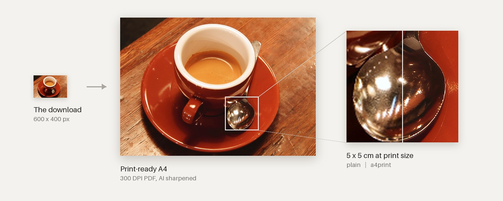
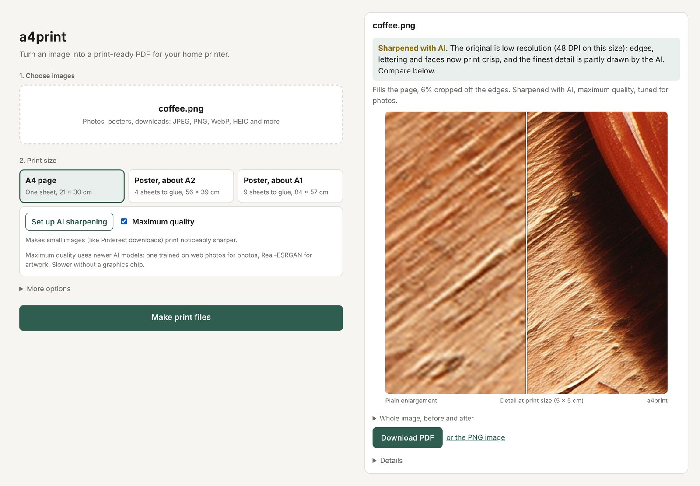
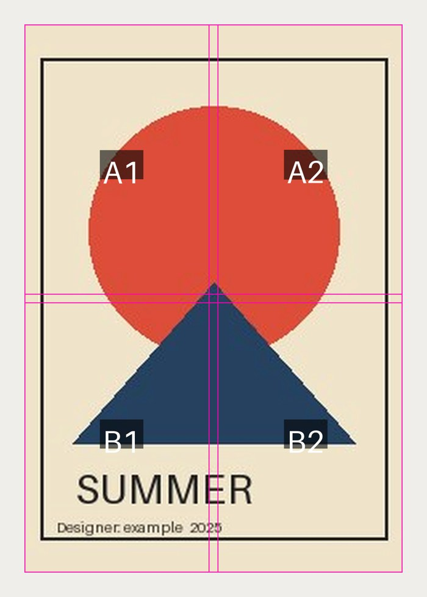

<div align="center">

# a4print

**Print-ready A4 pages and wall posters from any image, with AI upscaling that stays true to the original.**

[](https://github.com/flawnull/a4print/actions/workflows/tests.yml)


[](LICENSE)



<sub>5 x 5 cm of an A4 print from a 512 px photo. Left: plain enlargement. Right: <code>a4print --max-quality</code>. Portrait: NASA, public domain.</sub>

</div>

Most images worth printing are too small: a Pinterest download or a phone screenshot comes out soft and blocky on A4. a4print turns any image into a 300 DPI PDF sized for a home printer, as one page or a poster of several sheets. It fits the image to the page without cutting off what matters, cleans up compression artifacts, and can sharpen with AI models that run on your own computer.

## Quick start

```bash
pipx install "a4print[heic] @ git+https://github.com/flawnull/a4print"
```

```bash
a4print-web
```

Drop in an image, pick a size, download the PDF. Or from the terminal:

```bash
a4print photo.jpg --poster 2x2 --ai
```

New to pipx, or want AI upscaling? See the [install guide](docs/guide.md#install).

## Features

- **Smart fit.** Designed posters keep their frames and credit lines; the page is extended in the poster's own paper color and grain. Photos are cropped only when little is lost.
- **AI upscaling, kept honest.** Real-ESRGAN, or newer web-photo models with `--max-quality`. Tones come from the original and erased skin texture is put back, so prints look sharper, not retouched. Tiny text the AI would garble is left as is.
- **Posters on a home printer.** Split one image over 2 to 36 A4 sheets, with margins, overlap strips, alignment guides and labeled sheets.
- **Printer calibration.** A one-page test sheet measures how dark your printer prints, and every later print is tuned to it.
- **Cleanup only when needed.** Noise and JPEG artifacts are measured first; clean images are left alone. Black-and-white photos stay neutral gray.
- **Any input.** JPEG, PNG, WebP, AVIF, HEIC, TIFF, CMYK, 16-bit and float scans, transparency, EXIF rotation, color profiles.
- **Local and private.** Nothing is uploaded anywhere. The web page listens only on your own computer.

## Web app

`a4print-web` opens a small page in your browser. Choose images, pick an A4 page or a poster, and click once. Each result says in plain words how sharp the print will be, and a slider compares 5 x 5 cm of the print at actual size: plain enlargement against a4print, centered on a face when there is one.



AI setup is a button on the same page that downloads the official builds, checks their checksums and tests them. Batches download as one PDF. Uploads stay on your machine and are deleted when you stop the server.

## Posters



`--poster 2x2` makes a poster of about A2 from four A4 sheets; `3x3` is about A1. a4print picks portrait or landscape sheets to crop the least, keeps a white margin your printer can handle, and labels each sheet with where it goes and which edges to trim.

A test cuts and reassembles the sheets in software and checks the result against the poster pixel for pixel, so the pieces line up.

<br clear="right"/>

## How it works

Upscaling AIs have two habits that hurt a print: they shift tones, and they wipe out fine texture, which makes skin look waxy. a4print never prints the AI result directly. It splits the image into layers and takes each from the more faithful source: tones and gradients from a plain enlargement of the original, edges from the AI, and lost texture put back where the AI removed it.

| | AI alone | a4print |
|---|---|---|
| Tone drift on a portrait (Lab units; 2 is noticeable) | 1.5 average, 7 in the worst 1% | 0.2 average, 1 in the worst 1% |
| Skin texture kept | 49% | 100% |
| Edge sharpness | 1.41x plain | 1.40x plain |

Six AI models were compared before choosing the ones a4print uses, and every default here was measured the same way. The full pipeline, the model comparison and the engineering notes are in [how it works](docs/how-it-works.md).

## Built with

Python, OpenCV, Pillow and NumPy for image processing; img2pdf and pikepdf for PDFs; Real-ESRGAN (ncnn/Vulkan) and PyTorch with spandrel for AI upscaling; YuNet for face detection. The web page uses only Python's standard library and plain HTML, CSS and JavaScript.

Developed with [Claude Code](https://claude.com/claude-code) as an AI pair programmer: every change was measured on real images, covered by tests, and checked on all three operating systems.

```
a4print/
├── cli.py          command line, report wording
├── web.py          local web page and its server
├── pipeline.py     the processing steps, A4 pages and posters
├── layout.py       page geometry, fill modes, border detection
├── enhance.py      cleanup, tone curve, content and face detection
├── upscale.py      Lanczos, Real-ESRGAN, the layer merge
├── maxq.py         maximum quality models (PyTorch)
├── poster.py       poster planning, sheet slicing, guides
├── calibrate.py    printer test page and saved settings
├── setup_ai.py     verified downloads of AI programs and models
└── files.py        loading, sRGB, PNG/PDF/preview output
```

## Quality and security

About 150 tests run on Linux, macOS and Windows with Python 3.10 and 3.13, using only generated and public-domain images. AI programs and models are downloaded from their authors' releases and checked against pinned SHA-256 checksums; the web page refuses requests from other websites. Details in [SECURITY.md](SECURITY.md).

Print only images you have the right to use. `--remove`, which erases date stamps and marks, is meant for your own photos or images you're allowed to edit.

## Docs

- [Guide](docs/guide.md): install, every option, posters, calibration, common problems
- [How it works](docs/how-it-works.md): the pipeline, the AI merge, model comparison, engineering notes
- [Security](SECURITY.md)

## License

MIT, see [LICENSE](LICENSE). AI models and bundled components are credited in [THIRD_PARTY_NOTICES.md](THIRD_PARTY_NOTICES.md).
