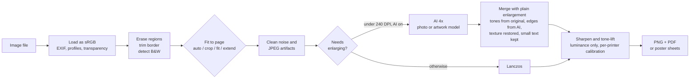

# How a4print works

The processing steps, and the measurements behind each choice. For usage, see the [guide](guide.md).

## What the processing does

In order:

1. Loads the image, applies EXIF rotation, puts transparency on white, and converts any embedded color profile (Adobe RGB, Display P3, CMYK) to sRGB.
2. Inpaints `--remove` regions with OpenCV (Telea method).
3. Trims plain margins if `--trim-border` is set. The margin color is the median of the outermost pixel ring, so white, beige and any flat color work.
4. Detects black-and-white images: 99% of pixels must be near-neutral (Lab chroma under 6) and almost none clearly colored, so a small colored logo keeps the image in color. B&W images are processed as one gray channel and saved with R = G = B, so a slight tint in the file can't turn into a color cast on paper.
5. Cleans up, only when needed. Small images are cleaned before enlarging, so problems aren't enlarged. Large images are shrunk first, which is faster and already hides most noise.
   - Sensor noise, measured in the flat half of the image (Immerkaer's method with edges excluded, after Tai & Yang 2008), so texture like hair or fabric isn't mistaken for noise. 30% of the original grain is blended back, so photos don't get a plastic look.
   - JPEG artifacts in heavily compressed files (quality under 80, typical for Pinterest and social media). The quality is read from the file's quantization tables, as ImageMagick does.
6. Crops or scales with Lanczos. With `--ai`, images under 240 DPI on paper go through Real-ESRGAN 4x, then Lanczos to the exact size, combined with a plain enlargement: tones from the original, edges from the AI, and texture the AI erased put back (see [AI upscaling](#ai-upscaling)). Sharper images skip the AI, since it would add minutes for no visible gain.
7. Adds the white border (`fit`), the blurred extension (`extend`) and the `--margin`, if any.
8. Applies a gentle unsharp mask and a shadow and midtone lift to luminance only (Lab L channel). Hue and saturation are left alone. Home inkjets print shadows darker than screens show them, which is what the lift compensates for.

a4print does nothing else. It doesn't retouch faces, change colors, or recompose the image.

The PDF stores the page as a quality-95 JPEG with no chroma subsampling. That keeps it to a few MB; the PNG is the lossless copy.

## AI upscaling

Small images (most Pinterest and social media downloads print at 35-90 DPI on A4) gain the most from `--ai`. Real-ESRGAN draws sharp edges and plausible fine detail such as hair, fur, fabric and lettering, where plain resizing gives a blur.

On its own, an upscaling AI has two habits that hurt a print: it shifts tones (on a test photo of a cat, lightness changed by up to 13 Lab units, where about 2 is noticeable), and it wipes out fine texture, which turns skin waxy. So a4print doesn't print the AI result directly. It combines it with a plain enlargement, layer by layer:

- **Tones and colors** come from the plain enlargement, which is faithful to the original. The drift drops to about 1 unit, and smooth gradients like skies don't turn into steps.
- **Edges and fine detail** come from the AI: crisp eyes, lettering, fur and outlines.
- **Texture the AI erased** (skin, paper grain) is put back from the original, area by area, in proportion to how much was lost. Where the AI sharpened or added detail, its result stays.

Measured on a portrait: tone drift fell from 1.5 to 0.2 on average, skin texture went from half the original to all of it, and edge sharpness stayed at the AI's level. This replaced an earlier global 70% AI / 30% plain mix, which helped skin a little but softened every edge.

- **Very small text** in artwork, like a credit line or date a few pixels tall, is left as a plain enlargement. At that size the AI invents letter shapes and "2025" can come out as a different number. The plain version is softer but still says what it said. a4print recognizes artwork by its hard, step-like edges and flat areas; photos change gradually across edges even when heavily compressed.

`--ai-strength` mixes the result with a plain enlargement (`1` by default, `0.5` for half the AI effect).

a4print's JPEG and noise cleanup runs before the AI. Without it, Real-ESRGAN turns JPEG blocks into invented blotches.

The preview (`name_preview.jpg`, and the slider on the web page) shows 5 x 5 cm of the print at actual size twice: as a plain enlargement of the original pixels and as a4print made it. It centers on the largest face, found with the YuNet detector, or else on the busiest area. That's where to judge what the AI did.

*A cat photo printed far beyond its resolution (36 DPI on A4). The AI draws convincing fur where the original only has blur. At this enlargement the strands are the AI's invention, not recovered detail; the photo is CC0, from scikit-image.*

What was tried and left out: Real-ESRGAN's illustration model (`realesrgan-x4plus-anime`) is 3 times faster but draws a white halo around edges, which shows on paper. You can still pick it with `--ai-model realesrgan-x4plus-anime`.

## Maximum quality models

`--max-quality` uses newer AI models run with [PyTorch](https://pytorch.org), picked per image:

- **Photos**: [4xNomosWebPhoto_esrgan](https://github.com/Phhofm/models) by Philip Hofmann, trained on web photos with JPEG and WebP compression, blur and noise.
- **Artwork and graphics**: Real-ESRGAN x4plus, which still draws the crispest edges and lettering.

Setup is in the [guide](guide.md#optional-maximum-quality).

How the models were chosen: six models were run on a photo of a cat, a portrait and a poster-style graphic, each through a4print's merge, and compared on edge sharpness and by eye.

| Model | Cat (fur) | Portrait | Graphic |
|---|---|---|---|
| Real-ESRGAN x4plus (`--ai`) | 210 | 212 | **444** |
| **4xNomosWebPhoto_esrgan** | **266** | **211**, more natural skin | 431 |
| 4xNomosWebPhoto_RealPLKSR | 218 | 184 | 428 |
| 4xRealWebPhoto_v4_dat2 | 164 | 171 | 409 |
| 4xNomosWebPhoto_atd | 209 | 174 | 434 |
| SwinIR-L (real-world GAN) | 195 | 186, glossy skin | 422 |

Newer designs weren't automatically better: the transformer models (DAT2, ATD, SwinIR) were softer and 3-5 times slower. The gain over `--ai` is real but moderate: crisper hair and fur and more natural skin on photos, and the same result on artwork.

## Engineering notes

Each of these was measured before it was kept.

| Area | Measurement |
|---|---|
| AI tone drift | Lightness drift against the original: 1.5 to 0.2 Lab units (portrait), 3.1 to 0.1 (cat) after the layer merge |
| Skin texture | Fine texture in smooth areas: 0.49 to 1.00 of the original, edge sharpness unchanged |
| Noise detection | Measuring only the flat half of the image: clean photos score under 2, noisy ones 3.2 and up, so texture isn't smoothed away |
| Artwork vs photo | Edge abruptness separates them: photos 0.86 or less even when compressed, graphics 0.95 or more |
| Tiled AI inference | 64 px overlap: 99.9% of pixels within 2 of 255 levels of a single whole-image pass, so no visible seams |
| Poster memory | 3x3 poster with AI from a 12 MP photo: peak 3.6 GB to 2.3 GB (strip-wise merge and filters, 8-bit blending) |
| Large photos | 48 MP photo: 28 s to 7 s by shrinking before cleanup; 120 MP JPEGs decode at reduced size in 2.6 s |
| Poster assembly | A test cuts and reassembles the sheets in software and compares the result with the poster pixel for pixel |

Testing: about 150 tests on Linux, macOS and Windows with Python 3.10 and 3.13, using generated and public-domain images only. Security is described in [SECURITY.md](../SECURITY.md).
