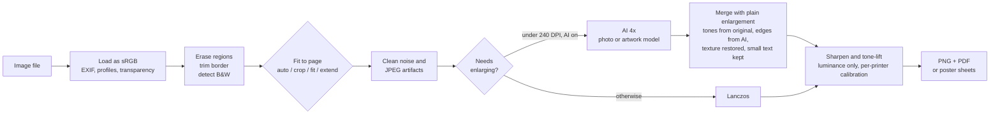
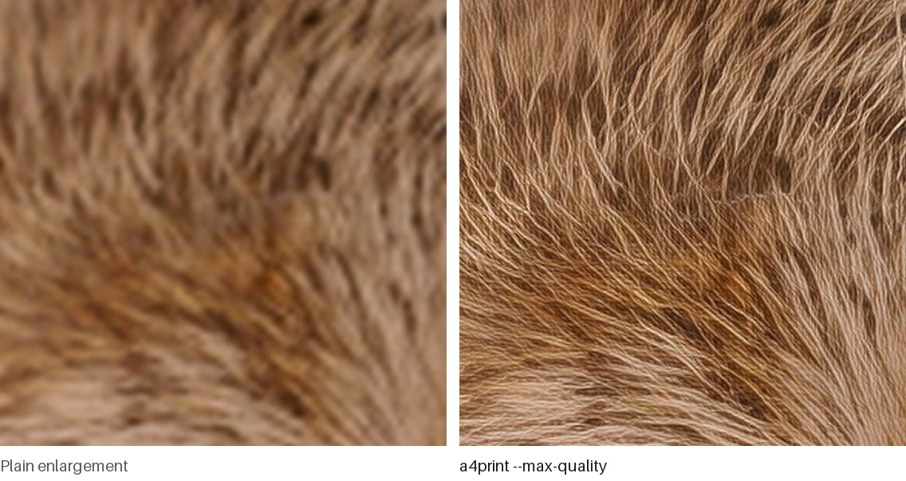

# How a4print works

The processing steps, and the measurements behind each choice. For usage, see the [guide](guide.md).

## What the processing does

In order:

1. Loads the image, applies EXIF rotation, puts transparency on white, and converts any embedded color profile (Adobe RGB, Display P3, CMYK) to sRGB.
2. Erases `--remove` regions. Inside each box it finds the marks themselves (text strokes, digits, a small logo) as the pixels that stand out from a median-filtered background, and inpaints only those with OpenCV (Telea method). The background between them stays original, and a frame line next to the box is not smeared in. A solid patch, or a mark too faint to tell apart, gets the whole box filled.
3. Trims plain margins if `--trim-border` is set. The margin color is the median of the outermost pixel ring, so white, beige and any flat color work.
4. Detects black-and-white images: 99% of pixels must be near-neutral (Lab chroma under 6) and almost none clearly colored, so a small colored logo keeps the image in color. B&W images are processed as one gray channel and saved with R = G = B, so a slight tint in the file can't turn into a color cast on paper.
5. Cleans up, only when needed. Small images are cleaned before enlarging, so problems aren't enlarged. Large images are shrunk first, which is faster and already hides most noise. Photos going through the AI are left to the AI, which removes noise and JPEG artifacts itself.
   - Sensor noise, measured in the flat half of the image (Immerkaer's method with edges excluded, after Tai & Yang 2008), so texture like hair or fabric isn't mistaken for noise. 30% of the original grain is blended back, so photos don't get a plastic look.
   - JPEG artifacts in heavily compressed files (quality under 80, typical for Pinterest and social media). The quality is read from the file's quantization tables, as ImageMagick does.
6. Crops or scales with Lanczos. With `--ai`, images under 240 DPI on paper go through an AI model at 4x (RealESRNet for photos, Real-ESRGAN for artwork), then Lanczos to the exact size, combined with a plain enlargement: tones from the original, edges from the AI, and texture the AI erased put back (see [AI upscaling](#ai-upscaling)). Sharper images skip the AI, since it would add minutes for no visible gain. Photos enlarged more than 2x get fine print grain, so they don't look painted (see [print grain](#ai-upscaling)).
7. Adds the white border (`fit`), the blurred extension (`extend`) and the `--margin`, if any.
8. Applies a gentle unsharp mask and a shadow and midtone lift to luminance only (Lab L channel). Hue and saturation are left alone. Home inkjets print shadows darker than screens show them, which is what the lift compensates for.

a4print does nothing else. It doesn't retouch faces, change colors, or recompose the image.

The PDF stores the page as a quality-95 JPEG with no chroma subsampling. That keeps it to a few MB; the PNG is the lossless copy.

## AI upscaling

Small images (most Pinterest and social media downloads print at 35-90 DPI on A4) gain the most from `--ai`. The AI sharpens the edges and fine structure the image has, such as hair, fabric, eyes and lettering, where plain resizing gives a blur. It can't bring back detail the download doesn't contain; for photos, a4print uses a model that doesn't try to (see [choosing the models](#choosing-the-models)).

On its own, an upscaling AI has two habits that hurt a print: it shifts tones (on a test photo of a cat, lightness changed by up to 13 Lab units, where about 2 is noticeable), and it wipes out fine texture, which turns skin waxy. So a4print doesn't print the AI result directly. It combines it with a plain enlargement, layer by layer:

- **Tones and colors** come from the plain enlargement, which is faithful to the original. The drift drops to about 1 unit, and smooth gradients like skies don't turn into steps.
- **Edges and fine detail** come from the AI: crisp eyes, lettering, fur and outlines.
- **Texture the AI erased** (skin, paper grain) is put back from the original, area by area, in proportion to how much was lost. Where the AI sharpened or added detail, its result stays.

Measured on a portrait: tone drift fell from 1.5 to 0.2 on average, skin texture went from half the original to all of it, and edge sharpness stayed at the AI's level. This replaced an earlier global 70% AI / 30% plain mix, which helped skin a little but softened every edge.

- **Very small text** in artwork, like a credit line or date a few pixels tall, is left as a plain enlargement. At that size the AI invents letter shapes and "2025" can come out as a different number. The plain version is softer but still says what it said. a4print recognizes artwork by its hard, step-like edges and flat areas; photos change gradually across edges even when heavily compressed.

`--ai-strength` mixes the result with a plain enlargement (`1` by default, `0.5` for half the AI effect).

For photos, a4print's own JPEG and noise cleanup is skipped when the AI runs: the photo model is trained to remove both, and cleaning first only took away real texture (0.72 against 0.67 SSIM to the original at 5x). Artwork is cleaned first, because Real-ESRGAN turns JPEG blocks into invented blotches.

The preview (`name_preview.jpg`, and the slider on the web page) shows 5 x 5 cm of the print at actual size twice: as a plain enlargement of the original pixels and as a4print made it. It centers on the largest face, found with the YuNet detector, or else on the busiest area. That's where to judge what the AI did.

*A cat photo printed far beyond its resolution (36 DPI on A4). The AI sharpens the strands the original has instead of drawing new ones, and fine grain keeps the fur from looking painted. Photo: CC0, from scikit-image.*

**Images enlarged before.** Many downloads, and every phone screenshot of one, were enlarged before they reached you: a 1168 px screenshot can hold the detail of a 425 px image. Given such an image, the AI sees blur at the wrong scale and turns compression traces into scratches and smears. a4print finds the real size as the largest shrink that changes the image by less than 2.5 of 255 levels (RMS), and the AI works from there. On nine photos at their real resolution the detector never fired; on synthetic enlarged copies the result was the same within 0.007 SSIM, and on a real phone screenshot it removed the smears. The verdict and the DPI on the web page follow the real detail.

**Print grain.** A photo enlarged more than about 3 times has no fine texture left, and even a faithful AI result prints as smooth areas that look painted. a4print adds fine luminance grain to those photos: none up to 2x, rising to 3 levels out of 255 at 5x, strongest in midtones and absent in white and black. The grain is random and about 0.07 mm across on paper, so it reads as photographic texture without drawing any shapes. `--no-grain` turns it off.

What was tried and left out: Real-ESRGAN's illustration model (`realesrgan-x4plus-anime`) is 3 times faster but draws a white halo around edges, which shows on paper. You can still pick it with `--ai-model realesrgan-x4plus-anime`.

## Choosing the models

The first versions picked AI models by eye and by edge sharpness, and chose GAN models: they draw the crispest detail. On real Pinterest downloads that went wrong. Small faces in a crowd came out as mannequins or cartoons, and a black-and-white photo got a fish-scale mesh across its flat areas. A GAN is trained to make detail that looks real, not detail that is there.

So the models were chosen again with a ground-truth test. Nine photos (crowds, group photos, a street scene, a portrait, a cat, a coffee cup) were shrunk the way Pinterest shrinks images (to a third or a fifth of their size, then saved as JPEG at quality 80), enlarged back with each method through a4print's merge, and compared with the originals. Faces were found in the originals with YuNet and also scored on their own.

| At 3x (100 DPI on A4) | SSIM | Face SSIM | Wrong detail | Face wrong detail |
|---|---|---|---|---|
| Plain enlargement | 0.802 | 0.817 | 0.87 | 0.83 |
| Real-ESRGAN x4plus (GAN) | 0.793 | 0.769 | 1.04 | 1.07 |
| 4xNomosWebPhoto_esrgan (GAN) | 0.760 | 0.772 | 1.18 | 1.19 |
| **RealESRNet x4plus** | **0.837** | **0.833** | **0.81** | **0.83** |

| At 5x (60 DPI on A4) | SSIM | Face SSIM | Wrong detail | Face wrong detail |
|---|---|---|---|---|
| Plain enlargement | 0.689 | 0.674 | 0.97 | 0.94 |
| Real-ESRGAN x4plus (GAN) | 0.678 | 0.612 | 1.13 | 1.25 |
| 4xNomosWebPhoto_esrgan (GAN) | 0.651 | 0.608 | 1.24 | 1.33 |
| **RealESRNet x4plus** | **0.735** | **0.711** | **0.93** | **0.93** |

*Wrong detail* is the fine-detail error against the original, relative to the fine detail the original has: above 1, a method adds more wrong detail than there was real detail. Both GAN models are above 1, and further above it on faces. RealESRNet, the Real-ESRGAN network trained without the GAN loss, was the most faithful on every measure and kept about twice the fine detail of a plain enlargement (0.77 of the original's at 3x, against 0.42).

It also helps at small enlargements: at 1.5x and 2x it was ahead of the plain enlargement on SSIM and wrong detail, with fine detail close to the original's (1.06). So the AI still runs up to 240 DPI.

What a4print uses now:

- **Photos**: RealESRNet x4plus, with `--ai` and with `--max-quality`. The Real-ESRGAN releases publish it only as PyTorch weights, so `a4print-setup-ai` downloads them, checks their checksum, and writes them into the ncnn layout of Real-ESRGAN x4plus, which is the same network. The converted file is checked against a second pinned checksum. Its output matches PyTorch within 0.7 of 255 levels on average.
- **Artwork and graphics**: Real-ESRGAN x4plus. On flat colors, outlines and lettering, crisp edges are what the original has, and the GAN draws them best.

`--max-quality` runs the same two networks with [PyTorch](https://pytorch.org) in full precision, and works where the Vulkan graphics driver `--ai` needs is missing. Setup is in the [guide](guide.md#optional-maximum-quality).

Earlier comparison, by edge sharpness only: SwinIR-L, DAT2, ATD and RealPLKSR were softer than the GAN models and 3 to 5 times slower, and Real-ESRGAN's illustration model drew halos.

## Engineering notes

Each of these was measured before it was kept.

| Area | Measurement |
|---|---|
| AI tone drift | Lightness drift against the original: 1.5 to 0.2 Lab units (portrait), 3.1 to 0.1 (cat) after the layer merge |
| Skin texture | Fine texture in smooth areas: 0.49 to 1.00 of the original, edge sharpness unchanged |
| Noise detection | Measuring only the flat half of the image: clean photos score under 2, noisy ones 3.2 and up, so texture isn't smoothed away |
| Artwork vs photo | Edge abruptness separates them: photos 0.86 or less even when compressed, graphics 0.95 or more |
| AI models | Ground truth, nine photos at 3x: SSIM 0.76 (previous photo model) to 0.84, face SSIM 0.77 to 0.83 |
| Cleanup before the AI | Skipped for photos: SSIM 0.67 to 0.72 at 5x |
| Tiled AI inference | 64 px overlap: 99.9% of pixels within 2 of 255 levels of a single whole-image pass, so no visible seams |
| Poster memory | 3x3 poster with AI from a 12 MP photo: peak 3.6 GB to 2.3 GB (strip-wise merge and filters, 8-bit blending) |
| Large photos | 48 MP photo: 28 s to 7 s by shrinking before cleanup; 120 MP JPEGs decode at reduced size in 2.6 s |
| Poster assembly | A test cuts and reassembles the sheets in software and compares the result with the poster pixel for pixel |

Testing: about 225 tests on Linux, macOS and Windows with Python 3.10 and 3.13, using generated and public-domain images only. Security is described in [SECURITY.md](../SECURITY.md).
